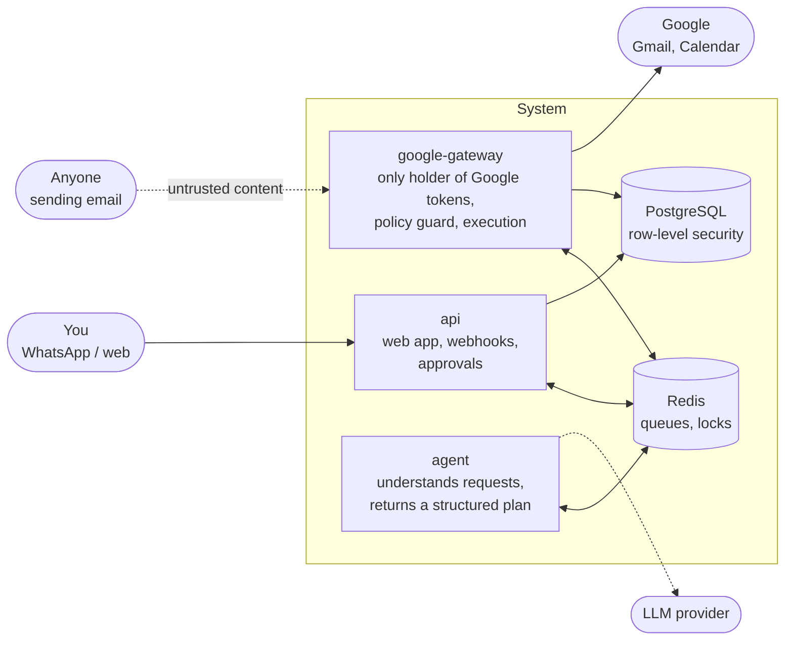

# scheduling-agent

[](https://github.com/efiphi/scheduling-agent/actions/workflows/ci.yml)

An AI agent that reads your Gmail, spots meeting requests, proposes free slots from Google Calendar, and **acts only after you approve**. You talk to it over WhatsApp and manage everything in a web app.

Scheduling agents are common. This one is built around a **threat model**: the agent reads email from anyone, so every design decision assumes an attacker is writing some of that email, and every defense is tested.

> **Status:** Layer 0 (skeleton) is complete — repository, CI, web UI structure, the first backend service, a hardened container, and database roles. Layer 1 (the end-to-end MVP) is in progress. See [build layers](#build-layers).

## How it stays safe

The core idea: **the component that reads untrusted email never holds the keys.**



- **Keys in one place.** Only `google-gateway` holds Google tokens. The `agent` has no tokens, no database access, and can reach only Redis and the LLM provider — a fully manipulated agent still cannot send email or touch the calendar.
- **Content is data, never instructions.** Email bodies and forwarded messages can never trigger an action or create an approval.
- **Decisions in code, not in the model.** The agent returns a plan in a fixed schema; unknown fields reject the whole message. A deterministic policy guard checks recipients, slot availability and content before anything runs.
- **Approvals are records, not text.** Single-use, bound to the user and to a hash of the exact action; any change invalidates them.
- **Isolation in the database.** Row-level security, and a separate database role per service — with no admin rights and no way to bypass RLS.
- **Emergency stop.** A secret code from a pre-registered backup phone, or a button in the web app, pauses the agent and cancels everything pending.

The full list is in [`CLAUDE.md`](CLAUDE.md) (security invariants) and the threat model (`docs/02-threat-model.md`, attacks T1–T30 and failures E1–E13). Tests that cover a threat are named after it, e.g. `test_t1_unknown_field_rejects_the_whole_message`.

## Repository layout

```
services/agent/           Understands a meeting request (Claude Haiku 5.5, structured output)
                          and returns a plan; LangGraph; Redis only, no DB, no Google + Dockerfile
services/api/             FastAPI service (web app API, webhooks, approvals) + Dockerfile
services/google_gateway/  The only holder of Google tokens: OAuth connect, Gmail polling and
                          the rule filter, token encryption + Dockerfile
packages/db/              SQLAlchemy models, Alembic migrations (RLS, grants), owner tools
packages/shared/          Messages between the services (Pydantic StrictModel)
web/                      React + TypeScript web app (Hebrew, right-to-left, mobile-first)
deploy/k3d/               Local Kubernetes cluster (k3s in Docker) for Layer 2
deploy/compose/           Local stack: Postgres, Redis, api, google-gateway, gmail-poller,
                          calendar-responder, agent;
                          database roles and their tests
evals/                    Synthetic emails that score the agent's understanding (run by hand)
redteam/                  Attack emails from the threat model, run through the real pipeline
docs/                  Design docs (Hebrew): use cases, threat model, architecture, web app
docs/adr/              Architecture decision records (English)
.github/workflows/     CI
```


## Quick start

**Prerequisites:** [Docker](https://docs.docker.com/get-docker/), [uv](https://docs.astral.sh/uv/), Node.js 24.

**Backend checks** (from the repository root):

```bash
uv sync
uv run pytest
```

**Local stack** — every port bound to `127.0.0.1`:

```bash
cp deploy/compose/.env.example deploy/compose/.env
# replace every "change-me" in deploy/compose/.env with a random value:
#   python3 -c "import secrets; print(secrets.token_urlsafe(32))"
# TOKEN_ENCRYPTION_KEYS:   uv run --package google-gateway python -m google_gateway.keys
docker compose -f deploy/compose/compose.yaml up -d --wait postgres redis api
curl http://127.0.0.1:8000/healthz
```

**Connect a Google account** (needs a Google Cloud OAuth client, ADR-010; the app stays in testing mode, so only its test users can connect):

```bash
# GOOGLE_CONNECT_CLIENT_ID / _SECRET in deploy/compose/.env, then:
(cd packages/db && MIGRATION_DATABASE_URL=... uv run alembic upgrade head)
docker compose -f deploy/compose/compose.yaml up -d --wait google-gateway gmail-poller calendar-responder
uv run --env-file deploy/compose/.env python -m db.dev create-user --email <demo account>
uv run --env-file deploy/compose/.env python -m google_gateway.connect --user-id <id>
# open the printed link, consent, then:
uv run --env-file deploy/compose/.env python -m google_gateway.verify --user-id <id>
```

From then on `gmail-poller` checks the mailbox every minute. Skipped emails are kept 7 days; the cleanup runs as the database owner: `python -m db.maintenance purge-skipped`.

Prove the database roles hold up (15 attack-style checks):

```bash
docker compose -f deploy/compose/compose.yaml exec -T postgres sh /tests/test-roles.sh
```

**Kubernetes (where the live demo runs since Layer 3):** [k3d](https://k3d.io) runs k3s inside Docker, bound to `127.0.0.1`. The system answers on the same addresses as under Compose (api on `:8000`, the gateway's OAuth callback on `:8001`, the WhatsApp webhook on `:8002`), so the Google redirect URIs and the tunnel do not change. Run one or the other, not both: they use the same ports.

```bash
k3d cluster create --config deploy/k3d/cluster.yaml
kubectl get nodes
```

The whole system runs from one Helm chart (`deploy/helm/scheduling-agent`): every service, Postgres, Redis, and the migrations as a Job. Secrets come from your `deploy/compose/.env`, sealed with the cluster's public key into `deploy/cluster/secrets/k3d/` (safe to commit, ADR-008), each component getting only its own keys:

```bash
docker compose -f deploy/compose/compose.yaml build api google-gateway agent
docker build -f packages/db/Dockerfile -t scheduling-agent-migrations:dev .
k3d image import -c scheduling-agent scheduling-agent-{api,gateway,agent,migrations}:dev
kubectl apply -f deploy/cluster/sealed-secrets/controller.yaml
deploy/k3d/seal-secrets.sh
kubectl apply -f deploy/cluster/secrets/k3d/
helm install scheduling-agent deploy/helm/scheduling-agent -n scheduling-agent --wait --wait-for-jobs
deploy/k3d/test-network-policies.sh   # attack-style check of the NetworkPolicies
kubectl -n scheduling-agent get pods
```

**GitOps (Argo CD):** after the cluster and its sealed secrets exist, Argo CD keeps it in sync with `main`. Every green CI run on `main` builds the images for amd64 and arm64, pushes them to GHCR, and commits their digests to `deploy/cluster/environments/k3d/values.yaml` (`.github/workflows/images.yml`); Argo CD deploys that commit. Nobody runs `helm` or `kubectl apply` after the first time:

```bash
deploy/cluster/argocd/install.sh                 # Argo CD itself, checksum- and digest-pinned
kubectl apply -f deploy/cluster/argocd/root.yaml # the app of apps
kubectl -n argocd get applications
```

Connecting a Google account on the cluster runs inside the gateway pod, which holds its secrets:

```bash
kubectl -n scheduling-agent exec deploy/google-gateway -- python -m google_gateway.connect --user-id <id>
```

Moving data from Compose to the cluster (one time; the app schema only, as the Postgres superuser):

```bash
docker compose -f deploy/compose/compose.yaml exec -T postgres \
  pg_dump -U postgres -d scheduling_agent --data-only --schema=app --exclude-table=app.alembic_version --disable-triggers \
  | kubectl -n scheduling-agent exec -i postgres-0 -- psql -U postgres -d scheduling_agent -v ON_ERROR_STOP=1
```

**Web app:**

```bash
cd web
npm ci
npm run dev
```

The UI is structure only for now: every screen renders its empty state until the API is connected in Layer 1.

## Development

```bash
pip3 install --user pre-commit   # once
pre-commit install               # once per clone
```

Every commit then runs gitleaks (secrets), ruff (Python lint and format) and basic hygiene checks. The gitleaks hook expects the `gitleaks` binary on your `PATH`.

| Check | Command |
|---|---|
| Python lint / format | `uv run ruff check .` · `uv run ruff format --check .` |
| Python types | `uv run mypy` |
| Python tests | `uv run pytest` |
| Python dependency audit | `uv run pip-audit --skip-editable` |
| Web lint / types / tests / build | `cd web && npm run lint && npm run typecheck && npm test && npm run build` |

**CI** runs on every pull request: gitleaks over the full history; Python (ruff, mypy, pytest, pip-audit); the web app (`npm audit`, lint, types, tests, build); both image builds (non-root check, no Google libraries in the api image, a google-gateway smoke test, Compose validation); and the database role, RLS and Redis tests against a fresh Postgres and Redis with throwaway passwords. Third-party actions and base images are pinned to commit SHAs and digests.

## Build layers

Each layer ends with something that works on its own.

| Layer | What | Status |
|---|---|---|
| 0 — Skeleton | Repo, CI with secret scanning, UI structure, api service, hardened container, database roles | ✅ Done |
| 1 — MVP core | Email → detection → slots → draft → approval → send + Meet event, on a demo account; WhatsApp | In progress |
| 2 — Kubernetes and GitOps | k3d, Helm, Argo CD, network policies | Planned |
| 3 — Observability | OpenTelemetry, Prometheus, Grafana, agent tracing | Planned |
| 4 — Evals and red team | Hebrew/English eval set and the attack corpus, both in CI | Planned |
| 5 — Detection | Detection rules as code, alerts | Planned |
| 6 — Cloud | Terraform on AWS, temporary environment | Planned |

## Decisions

Every significant decision has a one-page record — context, decision, alternatives, consequences, and when to revisit it — in [`docs/adr/`](docs/adr/README.md). Highlights:

- [ADR-006](docs/adr/006-four-services-by-key-ownership.md) — four services, split by who holds which key
- [ADR-010](docs/adr/010-split-oauth-flows.md) — two OAuth flows; every Google scope and why
- [ADR-014](docs/adr/014-stop-code-from-backup-numbers.md) — emergency stop only from registered backup numbers
- [ADR-015](docs/adr/015-llm-provider-and-model.md) — which model, why, and how API data is handled

## Data

Only a demo Google account and synthetic data are used in development, tests and fixtures. No real emails, names or phone numbers belong in this repository.
